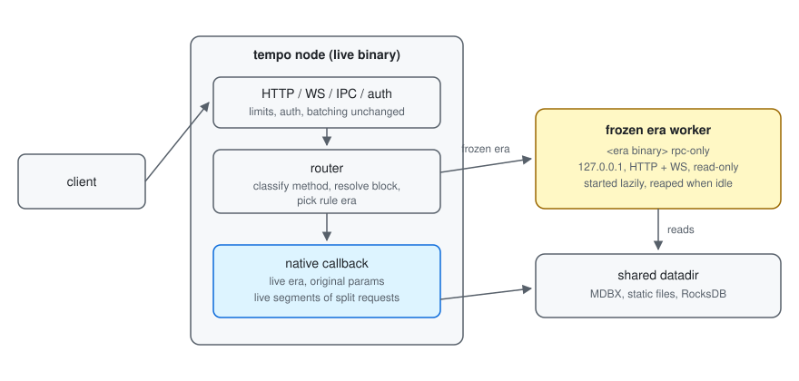

# tempo-metabinary

Executes frozen Tempo eras with their historical binaries, so a release can delete the
execution rules of every hardfork older than `TempoHardfork::MINIMUM_SUPPORTED` and still serve
full history.

Blocks before the floor are executed by a separately built **frozen era binary** that shares the
node's on-disk storage. Operators keep running `tempo node` with the same arguments; RPC, sync,
and `tempo re-execute` work over the whole chain, and the live binary never executes a frozen
block.



This crate is execution-independent; its only Tempo dependency is `tempo-hardfork`. The `tempo`
binary supplies the chain adapter (`eras.rs`), the `rpc-only` worker command, the startup
handoff (`history.rs`), and `re-execute` delegation (`re_execute.rs`).

## Release configuration

A release lists its frozen eras in a catalog. The built-in catalog is `bin/tempo/eras.json`; a
`tempo-eras.json` beside the executable supersedes it. Relative binaries resolve against the
catalog's directory. Unknown fields are rejected.

```json
{"chains":[{"chain_id":"0x1079","eras":[
  {"until":"T12","binary":"eras/tempo-genesis-t11",
   "checkpoint":{"number":43957544,"hash":"0x6c85…e452"}}]}]}
```

- `until` is the first hardfork the era does **not** execute. Its activation timestamp ends the
  era.
- `binary` is the era's executable.
- `checkpoint` is the era's last canonical block, used for the sync handoff.

Validation requires an executable per era, a scheduled activation for every `until`, strictly
increasing boundaries starting after genesis, strictly increasing checkpoints, and unique chain
IDs (compared by value, so `0x01079` duplicates `0x1079`).

### Boundaries

Block `b` belongs to era `i` when `boundaries[i-1] <= b.timestamp < boundaries[i]`. Era index
`boundaries.len()` is the live era, which runs in-process.

### Native fallback

Only the built-in mainnet and Moderato specifications have frozen eras, and only when their
genesis hash, genesis config, hardforks, and Tempo genesis info all equal the built-ins. Custom
genesis files (including ones that keep the genesis hash but change fork times), dev chains, and
unknown chains always run natively, so they must activate the floor at genesis.

Zone chains inherit their parent's fork activations and no catalog covers them. Before raising
the floor, confirm that no zone you serve has blocks timestamped before the parent's floor
activation.

### The floor

`TempoHardfork::MINIMUM_SUPPORTED` is the oldest hardfork the release executes.
`TempoEvmConfig::evm_env`/`next_evm_env` return `UnsupportedHardfork` below it, and the EVM's
system calls, transaction validation, execution, inspection, and block pre-execution re-check
`cfg.spec`, so changing the spec after env construction cannot bypass it. Consensus still reads
historical validator-config state without constructing an EVM.

## Workers

A worker is a frozen binary running `tempo rpc-only`: a private, read-only RPC server over the
shared datadir with no consensus, networking, or pool. It serves HTTP and WebSocket on one
loopback port and answers `tempo_executionInfo` (protocol version 1), which the node uses to
check the protocol, chain ID, genesis, read-only mode, and process ID before use. The handshake
detects port collisions; it is not authentication, and it does not establish execution
compatibility.

Workers inherit the node's resolved configuration: the exact genesis (written to a temporary
file), the datadir, custom static-file and RocksDB paths, and the RPC `EthConfig` (gas cap,
caches, proof window, tracing limits, and so on). Each process has its own concurrency budget,
while the public node keeps enforcing the operator's global limits; worker transport limits are
unbounded. Workers are selected per request regardless of `--full` or pruning, and missing state
fails through the worker's normal storage errors.

### Lifecycle

- **Lazy start.** The first request for an era spawns its worker on a free loopback port.
  Concurrent requests share one child. A caller dropped mid-handshake leaves the child to the
  next request, which resumes the same handshake.
- **Startup.** The handshake must succeed within 120 s. A failed start is reported for 30 s
  before the era is retried; the child is reaped and its RocksDB secondary removed.
- **Idle reaping.** Every 30 s, workers unused for 5 minutes are stopped. A worker is in use
  while a caller holds it, including open `traceChain` relays.
- **Stopping.** Children get SIGTERM, then SIGKILL after 10 s, and are always reaped. Node
  shutdown stops every worker and can be retried if cancelled.

Errors: an unavailable worker is `-32000`, a method the worker lacks is `-32004`, and worker
call errors pass through verbatim. Results are forwarded as raw JSON and never reserialized.

## Routing

Every request is routed by its **rule era**: the era whose binary owns the hardfork rules it
executes under. The public transports (HTTP, WS, IPC, and the authenticated engine API) keep
their registries, auth, CORS, compression, batching, subscriptions, and limits; only callbacks
of execution methods are replaced. Live requests reach the original callback with the original
params, so they behave exactly as before.

| Requests | Rule era |
|---|---|
| `eth_call`, `eth_estimateGas`, `eth_createAccessList`, `debug_traceCall`, `trace_call*`, `trace_rawTransaction`, block tracing and witness methods | The selected block; `pending` is live |
| `eth_feeHistory` | The newest block, with `pending` read as `latest`; invalid or zero counts are left to native |
| Transaction tracing (`debug_traceTransaction`, `trace_transaction`, `ots_traceTransaction`, …) | The containing block; pooled or unknown transactions are live |
| `eth_callBundle`, `eth_callMany`, `debug_traceCallMany` | The base block |
| `eth_simulateV1`, `tempo_simulateV1` | The generated blocks' explicit times, else the base block |
| `mev_simBundle` | The override time, else the parent block |
| `debug_traceBlock` | The RLP block's header timestamp |
| `trace_filter`, `reth_getBlockExecutionOutcome`, `debug_subscribe("traceChain")` | Split per era |

Non-executing methods (stored data, filters, signing, pool, engine, admin, and similar) stay
native. Any other method fails closed with `-32004 "{method} has no era routing policy"`.

Selected blocks are pinned before forwarding: explicit hashes (including EIP-1898
`requireCanonical`) are kept verbatim; other selectors become `{"blockHash": …}`, or the block
number for methods that only accept numbers.

### Overrides

Reth builds the EVM environment from the base header and only patches block-env fields, so a
monolithic binary runs a pre-boundary base under its own fork even with a post-boundary `time`
override. The router reproduces this: block overrides never change the era of `eth_call`-style
or base-block methods.

Only methods that generate a new block take their rules from its timestamp. Every explicit
simulated-block time must fall in one era, else the request fails with `-32004 "simulated blocks
span multiple eras"`: later blocks would need the unpersisted output of earlier ones, and
speculative state never crosses a process. Simulations without explicit times run in the base
era. Implicit times are filled by the executor, which rejects blocks past its own floor or
ceiling, so callers near a boundary should pass explicit times.

### Split requests

Canonical ranges are split at era boundaries. Each segment runs in its own era starting from
canonical stored state, sequentially in block order, and the first error fails the whole
request. Split points are found with a binary search over header timestamps, the same rule that
selects eras.

- `trace_filter` checks `fromBlock > toBlock` and the node's `max_trace_filter_blocks` over the
  whole range first. Segments run without pagination; the concatenated traces are then paged
  once with the caller's `after` and `count`, and segments stop once a full page is collected.
- `reth_getBlockExecutionOutcome` (1 to 128 blocks, clamped at the head) replays each segment
  from the canonical state before its first block. Parts merge into one outcome with
  `ExecutionOutcome::extend` after a strict, contiguous decode; a missing block truncates the
  result like native.
- `debug_subscribe("traceChain")` over a frozen era is relayed: one upstream subscription per
  segment is chained into the client's stream under the pre-allocated subscription ID. The empty
  end-block notification of a non-final segment is dropped, as the single native stream would
  skip it. A segment that ends early stops the relay. Unsubscribing or disconnecting drops the
  upstream subscription.

The public response size limit applies to the merged result.

## Sync handoff

Before `tempo node` opens storage for writing, each frozen era whose checkpoint the durable head
hasn't reached is synced by its binary, run as `node --history-sync` with the operator's
arguments (without follow mode) plus `--debug.tip`, `--debug.max-block`, and
`--debug.terminate` for the checkpoint. The durable head must then equal the checkpoint exactly,
and reached checkpoints must match the database's canonical hashes. `--dev` and `--debug` sync
modes skip this and require storage to already reach the last checkpoint.

When finality has not passed the last checkpoint, consensus bootstraps before its engine
starts: it reuses or fetches (from `--follow`'s upstream or the chain default) a finalization
verified against the trusted network identity, stores the block and then the certificate,
replays cached blocks or lets execution bulk sync to that floor, verifies the floor against its
epoch boundary's DKG outcome, caches the executed tail for offline restarts, and persists
finality only through the durable execution prefix. Marshal starts from the archived tip of a
sparse certificate archive when no block is missing up to it.

## Re-execution

`tempo re-execute` runs each frozen part of its range (`--to` exclusive, starting at block 1) in
the era's binary with `TEMPO_RE_EXECUTE_ERA` set, then the remainder in-process.

## Frozen artifacts

A frozen binary must reproduce exactly the rules its chains ran before the era's end, support
the current shared storage layout, and implement the worker interface: `rpc-only` with
`--rpc-config`, HTTP and WebSocket on one port with `debug_subscribe`, `tempo_executionInfo`,
and `node --history-sync`. It should reject specs at or above `until`.

## Packaging and source builds

Release archives and images ship `eras/`, `tempo-eras.json`, and their build metadata beside
`tempo`. Source builds must produce the frozen worker separately; a `tempo` without its eras
fails requests to frozen eras with `-32000` while serving everything else.
