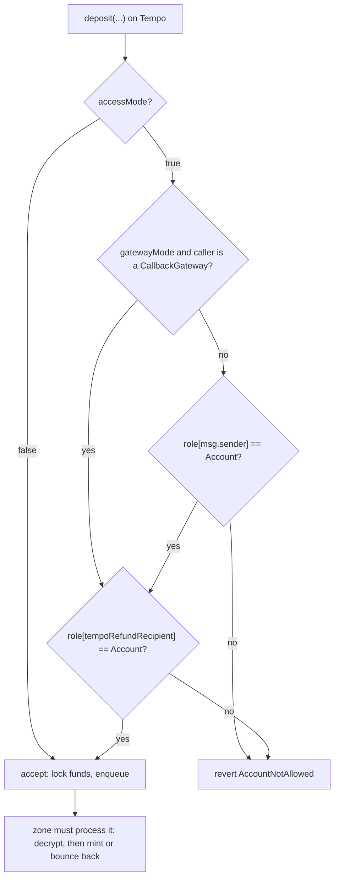
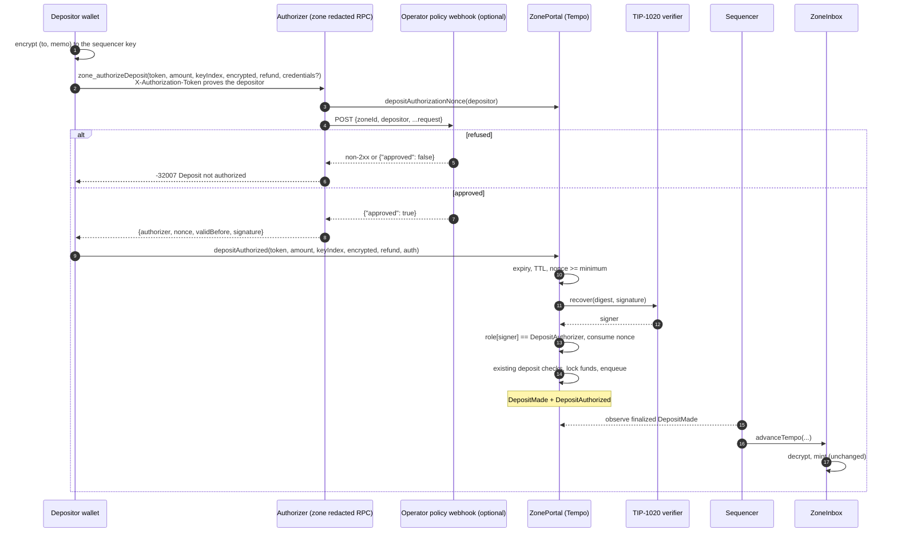
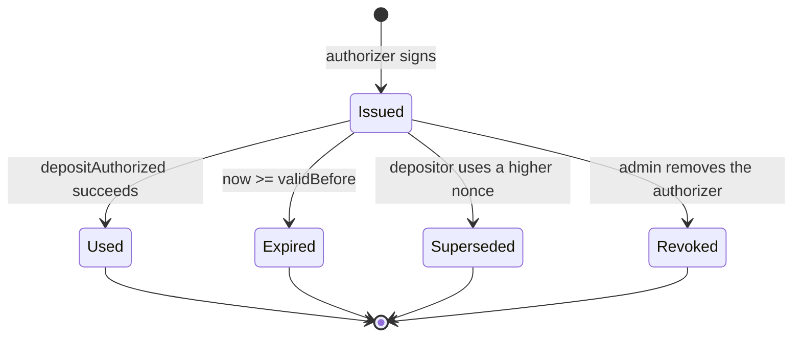
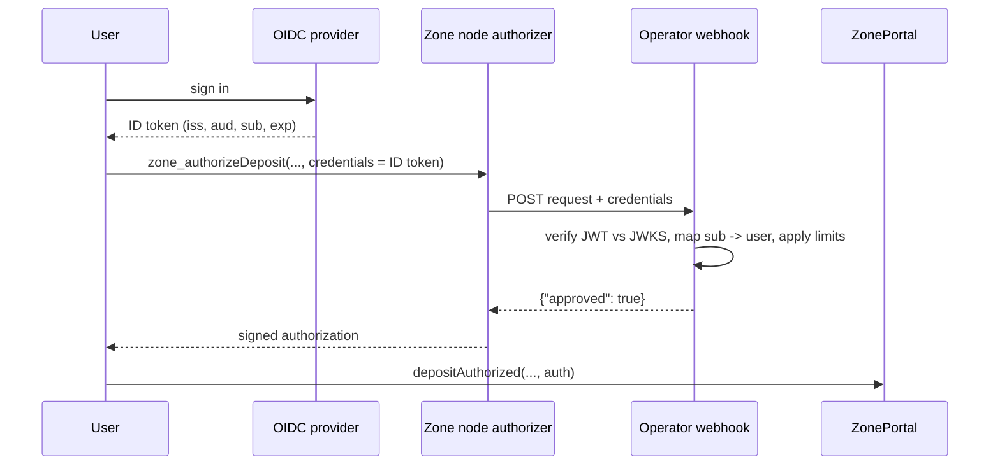

# TIP-1151: Signed Deposit Authorizations for Zone Portals

**Author:** Daniel Couser
**Status:** Draft TIP with a reference implementation
**TIP PR:** https://github.com/tempoxyz/tempo/pull/8429 (branch `tip/1151`)
**Implementation PR:** https://github.com/tempoxyz/tempo/pull/8430 (branch `zones/tip-1151-deposit-authorizations`)
**Activation:** T13 `ZonePortal` runtime

---

## 1. Summary

Today a zone either keeps an onchain allowlist of accounts that may deposit, or lets anyone deposit.
TIP-1151 adds a third option. Before depositing, the user asks the zone operator for permission. The
operator's **deposit authorizer** applies whatever policy the application wants (a signed-up user,
a passed OIDC sign-in, a spending limit) and signs a short-lived EIP-712 message. The user submits that
signature with the deposit, and the portal on Tempo verifies it before accepting the funds.

Users get in without an onchain transaction. The zone never receives deposits it would refuse, so
nothing has to be bounced back. The zone-side state transition, the prover, and the deposit queue
encoding do not change.


---

## 2. Problem

A deposit is a call to `ZonePortal.deposit(token, amount, keyIndex, encrypted, tempoRefundRecipient)`
on Tempo. The portal escrows the tokens and appends the deposit to a hash chain. The zone mints the
deposit the next time it imports Tempo (`advanceTempo`).

Admission is controlled by the portal's `accessMode` flag and its role mapping:



Both modes fail dynamic applications:

| Problem | Closed access (allowlist) | Open access |
|---|---|---|
| Onboarding a user | One admin transaction per user (`setAllowedAccount`), from a hot admin key or queued behind a cold key | None |
| Application policy ("only signed-up users", limits, KYC tier) | Only a binary onchain role | Impossible |
| Privacy | The allowlist is public and reveals every customer, including ones who never deposit | Fine |
| Unwanted deposits | Rejected on Tempo | Must be processed. The zone has no accept or reject input; it mints every deposit that decrypts and passes TIP-403 |


**Rejected alternative: let the sequencer refuse deposits on the zone and bounce them back.** That
adds a discretionary input to the proven state transition, charges bounce-back fees to users who were
never eligible, delays refunds by a batch, and leaves refused deposits visible on Tempo. Refusing
on Tempo, before funds are escrowed, is cheaper and simpler.

---

## 3. Goals and non-goals

**Goals**

- Onboard a user with no onchain transaction.
- Let the operator apply any offchain policy before funds enter the portal.
- Keep the zone-side state transition, prover, and deposit queue unchanged.
- Keep sequencer settlement keys off the public request path.
- Leave room for OIDC, enclave, and onchain-proof authorizers without another portal redesign.

**Non-goals**

- Changing withdrawal or callback gating. The existing `accessMode` and `gatewayMode` checks keep
  working for withdrawals.
- Forced inclusion. If the authorizer refuses, the user's funds stay on Tempo.
- Standardizing the operator's policy. Whether to sign is not consensus.

---

## 4. Design

### 4.1 Moving parts

| Component | Role | New? |
|---|---|---|
| Admin | Registers authorizer keys (`setDepositAuthorizer`) and turns the mode on (`setDepositAuthMode`) | New functions |
| Deposit authorizer | Key with the portal's new `DepositAuthorizer` role. Applies policy and signs | New offchain service |
| `zone_authorizeDeposit` | Authenticated RPC method users call to get an authorization | New RPC method |
| `ZonePortal.depositAuthorized` | Verifies the authorization, consumes a nonce, then runs the normal deposit logic | New entry point |
| TIP-1020 signature verifier | Recovers the signer for secp256k1, P256, and WebAuthn signatures | Existing |
| Deposit queue, `ZoneInbox`, prover | Process the deposit exactly as before | Unchanged |

### 4.2 End-to-end flow



The user encrypts the payload before asking, because the authorization binds the exact ciphertext.
The redacted RPC already authenticates callers with `X-Authorization-Token`, which proves the caller
controls a Tempo account. That account is the depositor, so the authorizer knows whom it is signing
for without a new login mechanism.

### 4.3 The signed message

The authorizer signs an EIP-712 message under the portal's existing domain: name `ZonePortal`,
version `1`, the Tempo chain ID, and the portal address.

```text
DepositAuthorization(
    address depositor,             // must equal msg.sender
    address token,
    uint128 amount,                // gross, before fees
    uint256 keyIndex,
    bytes32 payloadHash,           // hash of the encrypted (to, memo)
    address tempoRefundRecipient,
    uint64  nonce,
    uint64  validBefore            // unix seconds
)

payloadHash = keccak256(abi.encode(
    ephemeralPubkeyX, ephemeralPubkeyYParity, keccak256(ciphertext), nonce, tag))
```

Each field blocks a specific misuse:

| Without binding... | ...an attacker could |
|---|---|
| `depositor` | Copy an authorization from the mempool and use it from another account |
| `token`, `amount` | Deposit a different asset, or more than was approved |
| `payloadHash`, `keyIndex` | Reuse the approval to fund a different zone recipient |
| `tempoRefundRecipient` | Route a bounce-back to an address the operator never vetted |
| `nonce` | Replay the approval inside its validity window, defeating per-user limits |
| `validBefore` | Use an approval long after the operator's policy changed |
| Domain (chain ID, portal) | Use an approval on another zone or chain |

Binding the ciphertext has a useful side effect. An authorizer that holds the sequencer's encryption
key can decrypt the payload and apply recipient-aware policy. A third-party authorizer cannot decrypt
it, but the binding still prevents reuse for another recipient.

### 4.4 What the portal checks


While the mode is enforced, the legacy `deposit` and `depositEncrypted` entry points revert with
`DepositAuthorizationRequired`. The one exception is a `CallbackGateway` caller while gateway mode is
enforced, so synchronous callback returns keep working.

### 4.5 Lifecycle of an authorization



### 4.6 Design decisions

**A dedicated authorizer role, not the sequencer keys.** Settlement keys sign threshold settlement
attestations and should not sit behind a public HTTP endpoint. Portal roles are mutually exclusive,
so a `DepositAuthorizer` key cannot settle batches and a sequencer key cannot authorize deposits.
The admin can register several authorizers. That allows one key per node, rotation by
add-then-remove, and keys held in a KMS, HSM, or enclave.

**Monotonic per-depositor nonces.** The portal stores the lowest nonce it still accepts for each
depositor. Using nonce `n` sets the minimum to `n + 1`. Nonces may skip and never stall: an unused
authorization becomes invalid once a higher one is used. Only the depositor can consume its own
nonces, so third parties cannot grief them.

**Short, capped validity.** The portal rejects authorizations valid for more than one hour
(`MAX_DEPOSIT_AUTHORIZATION_TTL = 3600`). The reference authorizer issues two-minute authorizations
by default.

**TIP-1020 instead of contract verifiers.** TIP-1020 already covers secp256k1, P256, and WebAuthn,
which covers cloud KMS, HSM, and enclave keys. Calling arbitrary ERC-1271 contracts would add an
external call to the deposit path; that hook can come later if onchain OIDC proofs need it.

**Refunds follow the deposit decision.** In authorization mode, deposit bounce-back delivery and
`claimRefund` skip the `Account` role check. Otherwise refunds to authorized depositors, who
normally hold no role, would be parked indefinitely.

**Withdrawals are untouched.** A zone that wants permissionless entry with offchain policy sets
`accessMode = false` and `depositAuthMode = true`. A zone that also wants closed-loop withdrawals keeps
`accessMode = true` and uses its allowlist only for withdrawal destinations.

**Abdication.** After `Capability.AccessPolicy` abdication, the admin can no longer change the mode or
add authorizers, but can still remove them. A frozen authorizer set therefore stays credible and
compromised keys can still be revoked.

**Hardfork placement.** The change edits the T13 portal runtime in place, as TIP-1098 did, because T13
is not yet scheduled on mainnet or moderato.

---

## 5. The change set


### 5.1 Tempo L1: `ZonePortal` (consensus)

Files: `crates/zones/contracts/src/runtime/tempo/ZonePortal.sol`,
`crates/zones/contracts/src/runtime/interfaces/IZone.sol`.

| Addition | Behavior |
|---|---|
| `Role.DepositAuthorizer` (value 5) | New mutually exclusive portal role. Grants only deposit-authorization power |
| `setDepositAuthMode(bool)` | Admin only. Emits `DepositAuthModeUpdated`. Reverts after `AccessPolicy` abdication |
| `setDepositAuthorizer(address, bool)` | Admin only. Rejects the zero address, the messenger, and accounts holding another role. Additions are frozen after abdication; removals are always allowed |
| `isDepositAuthEnforced()` | Reads the mode flag |
| `depositAuthorizationNonce(address)` | Lowest nonce still accepted for a depositor |
| `depositAuthorizationDigest(...)`, `DOMAIN_SEPARATOR()` | Let clients and SDKs check their local encoding |
| `MAX_DEPOSIT_AUTHORIZATION_TTL()` | 3600 seconds |
| `depositAuthorized(token, amount, keyIndex, encrypted, refund, DepositAuthorization{nonce, validBefore, signature})` | Runs the checks in section 4.4, consumes the nonce, queues the deposit through the same internal path as `deposit`, and emits `DepositMade` then `DepositAuthorized(depositNumber, depositor, authorizer, nonce)` |
| Errors | `DepositAuthorizationRequired`, `DepositAuthorizationNotEnforced`, `DepositAuthorizationExpired`, `DepositAuthorizationTooLong`, `DepositAuthorizationNonceInvalid`, `InvalidDepositAuthorization`, `UnauthorizedDepositAuthorizer` |

The internal deposit logic was split into an admission gate and `_enqueueDeposit`, which returns both
the new queue hash and the deposit number. `deposit` and `depositAuthorized` share `_enqueueDeposit`,
so the queue entry and `DepositMade` event are identical.

**Storage.** Two additions preserve the existing layout:

| Slot | Offset | Variable |
|---|---|---|
| 21 | 2 | `_isDepositAuthEnforced` (packed after `_isAccessEnforced` and `_isGatewayEnforced`) |
| 29 | 0 | `depositAuthorizationNonce` mapping |

The storage layout snapshot (`storage-layouts/ZonePortal.json`), the native factory's
`ZonePortalStorage` in `crates/precompiles/src/zone_factory/portal.rs`, and the Rust slot-constant
test are updated to match.

**Runtime bytecode.** `T13_ZONE_PORTAL_RUNTIME` in `crates/contracts/src/zones.rs` is regenerated
from the Foundry build (about 24.0 KB to 26.3 KB, within the protocol code-size budget), and the same
bytecode is written into `crates/chainspec/src/genesis/dev.json` and
`crates/node/tests/assets/test-genesis.json`.

### 5.2 Shared bindings: `tempo-contracts`

File: `crates/contracts/src/zones/zone_portal.rs`.

- `sol!` bindings for the new role, struct, events, errors, and functions, including `Display` arms
  for the new errors.
- `eip712::DepositAuthorization` with `signing_hash(chain_id, portal)`, which reproduces
  `depositAuthorizationDigest` off chain.
- `DepositPayload::authorization_hash()`, which reproduces `payloadHash`.

### 5.3 Zone node: authorizer service (offchain)

Files: `crates/zones/rpc/src/deposit_auth.rs` (new), `crates/zones/rpc/src/types.rs`,
`crates/zones/rpc/src/handlers.rs`, `crates/zones/node/src/{rpc,node,cli}.rs`.

**`DepositAuthorizer`.** Holds the authorizer key, the lifetime of issued authorizations, and an
optional policy webhook URL. For each request it:

1. Calls the webhook if one is configured. Without a webhook, every authenticated depositor is
   approved.
2. Sets `validBefore = now + ttl`.
3. Builds the EIP-712 digest for the Tempo chain ID and portal address, and signs it.
4. Returns the 65-byte signature, nonce, `validBefore`, and authorizer address.

**`zone_authorizeDeposit`** on the redacted RPC. The node reads the depositor's current
`depositAuthorizationNonce` from the portal on Tempo and passes it to the authorizer. Nodes without
an authorizer return `-32006 Method disabled`.

Request:

```json
{
  "jsonrpc": "2.0", "id": 1, "method": "zone_authorizeDeposit",
  "params": [{
    "token": "0x20c0000000000000000000000000000000000000",
    "amount": "0x7a120",
    "keyIndex": "0x0",
    "encrypted": {
      "ephemeralPubkeyX": "0x…",
      "ephemeralPubkeyYParity": 2,
      "ciphertext": "0x…",
      "nonce": "0x…",
      "tag": "0x…"
    },
    "tempoRefundRecipient": "0x…",
    "credentials": { "idToken": "eyJ…" }
  }]
}
```

Response:

```json
{
  "authorizer": "0x…",
  "nonce": "0x0",
  "validBefore": "0x6553f178",
  "signature": "0x…65 bytes…"
}
```

**Policy webhook.** When `--deposit-authorizer.policy-url` is set, the node POSTs this body, with a
5-second timeout:

```json
{
  "zoneId": 7,
  "depositor": "0x…",
  "token": "0x…", "amount": "0x…", "keyIndex": "0x…",
  "encrypted": { "…": "…" },
  "tempoRefundRecipient": "0x…",
  "credentials": { "idToken": "eyJ…" }
}
```

The node signs only after a 2xx response with `{"approved": true}`. Any other status or body returns
`-32007 Deposit not authorized`. If the webhook is unreachable, the node returns `-32603` and does
not sign. This webhook is where operators plug in allowlists, signup state, rate limits, or OIDC
verification.

**Node flags.**

| Flag | Env | Default | Meaning |
|---|---|---|---|
| `--deposit-authorizer.key-file` | `DEPOSIT_AUTHORIZER_KEY_FILE` | unset | Hex private key that holds `DepositAuthorizer`. Enables `zone_authorizeDeposit` |
| `--deposit-authorizer.ttl-secs` | `DEPOSIT_AUTHORIZER_TTL_SECS` | 120 | Lifetime of issued authorizations; must be 1 to 3600 |
| `--deposit-authorizer.policy-url` | `DEPOSIT_AUTHORIZER_POLICY_URL` | unset | Operator policy webhook |

**Zone metadata.** `zone_getZoneInfo` now returns `isDepositAuthEnforced`, so wallets know whether to
request an authorization or use `deposit`.

**Nonce issuance.** The node issues the current onchain nonce. This keeps the authorizer stateless. If
one depositor makes two requests concurrently, both get the same nonce, only the first deposit
succeeds, and the client requests a new authorization.

### 5.4 Operator tooling: `xtask`

File: `xtask/src/zones/portal_access.rs`.

```bash
cargo zone-xtask set-deposit-authorizer <AUTHORIZER_ADDRESS> --allowed \
  --l1-rpc-url $L1_RPC_URL --portal $PORTAL --admin-key $ADMIN_KEY
cargo zone-xtask set-deposit-auth-mode --enforced \
  --l1-rpc-url $L1_RPC_URL --portal $PORTAL --admin-key $ADMIN_KEY
```

Both commands also accept `--safe-address` and `--safe-output` to write a Safe Transaction Builder
proposal instead of sending, like the existing access commands.

### 5.5 Documentation

- `tips/tip-1151.md`: the normative TIP.
- `zones/specs/spec.md`: roles, the permission matrix, the new "Signed Deposit Authorizations"
  subsection, the storage table, `IZonePortal`, the redacted RPC method list, `zone_authorizeDeposit`,
  and error code `-32007`.
- `zones/invariants.md`: `TEMPO-ZONE-DEPOSIT-AUTH-REQUIRED`, `-SINGLE-USE`, and `-ALIAS`.
- `.changelog/tip-1151.md`: changelog entry for `tempo-contracts` and `tempo-chainspec`.

### 5.6 What does not change

- Zone execution, the prover, and the deposit queue encoding.
- Withdrawals, callbacks, gateway checks, TIP-403 enforcement, and bounce-back mechanics.
- The factory. Existing T13 zones opt in with two admin calls.

---

## 6. Testing

| Layer | What runs | Result |
|---|---|---|
| Solidity | 17 new Forge tests: unlisted depositor admitted with the legacy queue encoding; mode off; legacy deposit blocked for allowlisted accounts; expiry exactly at `validBefore` and TTL exactly at the maximum; nonce skipping and invalidation; a copied authorization from another account; each signed field mutated individually; revoked authorizer; malformed signature; P256 authorizer; paused portal; admin-only setters and abdication; role validation; removal after abdication; gateway exemption; refunds | 532 of 532 Forge tests pass. Six deliberate mutations of the checks were each caught |
| Storage | Layout snapshot compared with `forge inspect`; Rust slot-constant tests for the two new variables | Pass |
| Encoding | Rust test pins `signing_hash` and `authorization_hash` to a vector computed independently with `cast` | Pass |
| Authorizer | Unit tests: signature recovers to the authorizer over the expected digest; webhook approval, refusal (`approved: false`, empty body, HTTP 403), unreachable webhook fails closed; TTL bounds | Pass |
| End to end | zone-node e2e on a real Tempo dev node with the T13 portal: admin registers an authorizer and enables the mode; an account outside the allowlist is refused by `deposit`; the default RPC returns `-32006`; the authorizer RPC issues an authorization; `depositAuthorized` succeeds; the zone mints; replay fails with `DepositAuthorizationNonceInvalid`; `zone_getZoneInfo` reports the mode | Pass |
| Negative control | The same e2e with the authorizer signing for the wrong chain ID | Fails with `UnauthorizedDepositAuthorizer`, as expected |
| Regression | Existing real-L1 deposit and closed-mode e2e tests, zone metadata e2e, `tempo-evm` and `tempo-precompiles` zone tests, chainspec tests, xtask tests, clippy | Pass |

---

## 7. Security and threat model

- **Admin.** Trusted. Chooses the mode and the authorizer set, and can revoke an authorizer at any
  time.
- **Deposit authorizer.** Trusted to apply the operator's policy. A compromised key can admit
  deposits of the attacker's own funds to any recipient until it is revoked. It cannot withdraw,
  redirect existing deposits, or affect settlement. The one-hour cap bounds how long a stale decision
  stays usable.
- **Sequencer operator.** Already trusted for liveness. If it runs the authorizer, it can refuse
  deposits before they reach the portal instead of only failing to produce blocks. Refused users
  keep their funds on Tempo.
- **Depositor.** Untrusted. Cannot reuse an authorization for another recipient, amount, token,
  refund recipient, zone, or chain, or after its nonce is consumed.
- **Front-runners.** Can see pending authorizations in the mempool but cannot use them, because
  `msg.sender` must equal the signed depositor.
- **Availability.** If every authorizer is down, only enforced gateways can deposit. Operators should
  run more than one.

**Gas.** Compared with `deposit`, `depositAuthorized` adds the authorization calldata, one TIP-1020
recovery (3,000 gas for secp256k1, 8,000 for P256 or WebAuthn, plus input cost), one cold role read,
one nonce read and write, and one event. A depositor's first authorized deposit creates the nonce
slot, which costs 250,000 gas under TIP-1000 unless the portal has a TIP-1060 storage credit.
Onboarding through `setAllowedAccount` creates a slot at the same cost, but the admin pays it for
every user, including users who never deposit.

---

## 8. OIDC integration

Signed authorizations are the substrate for "Sign in with Google" onboarding. Every option below
except the last is a different way to run the authorizer.

| Level | Who checks the OIDC login | Portal change beyond TIP-1151 | Operator sees identity? |
|---|---|---|---|
| 0. OIDC at the authorizer | Operator's webhook | None | Yes |
| 1. Enclave authorizer | Measured enclave code | None (admin verifies attestation) | No |
| 2. OIDC-native accounts | Tempo protocol (draft TIPs 1130 to 1133) | None | No |
| 3. Onchain OIDC policy | Portal, through a ZK proof | New verifier path | No |

**Level 0, available now.** The wallet passes an ID token in `credentials`. The webhook verifies it
against the provider's JWKS, checks `iss`, `aud`, `exp`, and the claims it cares about, maps `sub` to
a user, and approves.



**Level 1, the whiteboard flow.** The authorizer runs in a TEE such as AWS Nitro. It generates its
key inside the enclave, keeps an encrypted table that binds OIDC subjects to Tempo addresses, and
signs only when its measured policy allows. The admin verifies the attestation and registers the
enclave key once. This makes the policy auditable, hides identities from operator staff, enforces
one identity per address without a public list, and makes the key unexportable. Abdicating
`AccessPolicy` after registration freezes the authorizer set. A future attested-authorizer registry
could replace the admin's attestation check onchain.


**Level 2.** If draft TIPs 1130 to 1133 (OIDC signers with ZK proofs) land, the depositor can itself
be an OIDC identity. The authorizer can then verify that an address belongs to an identity from an
issuer without learning who the user is.

**Level 3.** The portal verifies a ZK proof that a published provider key signed an ID token whose
`nonce` commits to the deposit digest, with a nullifier for per-identity limits. That removes the
authorizer entirely, needs a contract-callable proof verifier, and is a separate TIP. TIP-1151 does
not block it.

**Recommendation.** Ship TIP-1151 with the webhook (Level 0). Prototype Level 1 on Nitro, reusing the
TIP-1098 attestation tooling. Revisit Levels 2 and 3 when a contract-callable proof verifier exists.

---

## 9. Rollout

1. Merge the TIP and implementation. The new portal code ships in the T13 runtime.
2. For each zone that wants it, the operator generates an authorizer key (KMS, HSM, or enclave
   recommended) and runs a zone node with `--deposit-authorizer.key-file` and, usually,
   `--deposit-authorizer.policy-url`.
3. The admin calls `set-deposit-authorizer <key> --allowed`, then `set-deposit-auth-mode --enforced`.
4. Wallets read `isDepositAuthEnforced` from `zone_getZoneInfo`, call `zone_authorizeDeposit`, and
   submit `depositAuthorized`.
5. Operators monitor `DepositAuthorized` events by authorizer and the RPC refusal and error rates.

---

## 10. Open questions

1. Should active sequencers be able to rotate authorizer keys within an admin-set limit?
2. Exact or maximum amount: the authorization binds the exact gross amount. A maximum would tolerate
   fee changes between issuance and inclusion, at the cost of weaker limits.
3. Is 250,000 gas on a depositor's first authorized deposit acceptable, or is a cheaper replay scheme
   worth its complexity?
4. Should the same pattern replace the withdrawal-destination allowlist, verified zone-side?
5. Should `credentials` get a standard OIDC schema so wallets integrate once across zones?
6. Should the reference authorizer track issued nonces so concurrent requests from one depositor
   do not collide?
